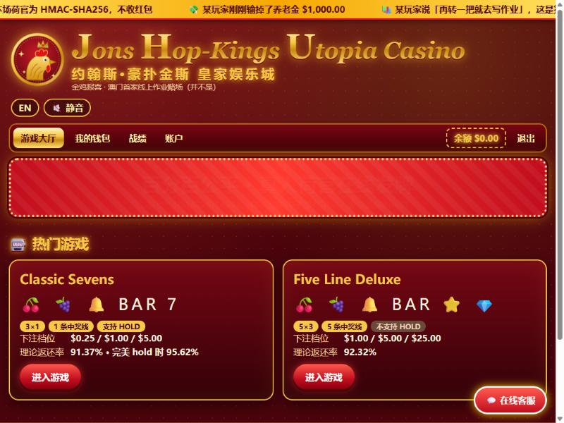
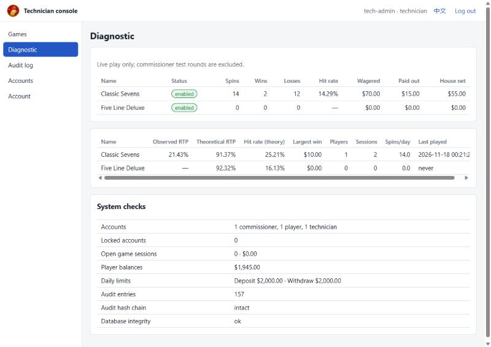
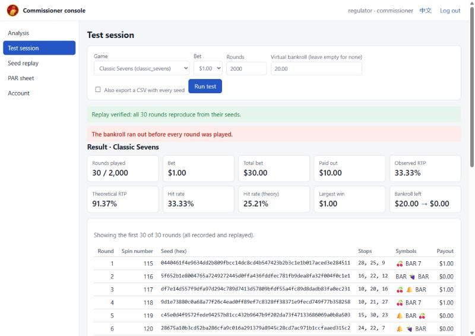
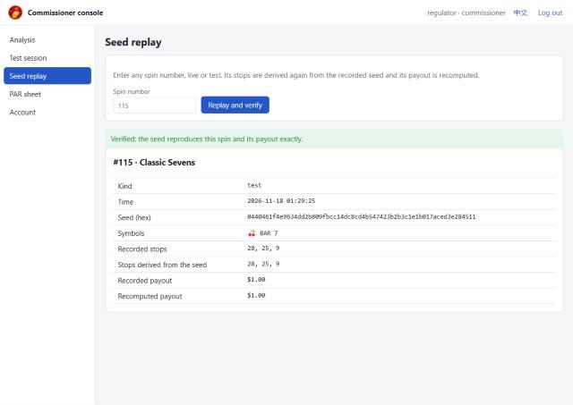

# User Manual — Big Casino Secure Slot Machine

This manual covers everything the system does, for each of its three user
groups. Install it first with [`INSTALL.md`](INSTALL.md).

**Contents**

1. [How the system works](#1-how-the-system-works)
2. [First run: five-minute walkthrough](#2-first-run-five-minute-walkthrough)
3. [Using the menus](#3-using-the-menus)
4. [Players](#4-players)
5. [Big Casino Technicians](#5-big-casino-technicians)
6. [Big Gamble Commissioners](#6-big-gamble-commissioners)
7. [The games](#7-the-games)
8. [Security features you will notice](#8-security-features-you-will-notice)
9. [Where each requirement is met](#9-where-each-requirement-is-met)
10. [Command-line reference](#10-command-line-reference)

---

## 1. How the system works

`slotmachine` is a terminal (command-line) program. Everything is stored in one
SQLite database file, `casino.db`, in the folder you run it from.

There are three kinds of account, and each sees only its own menu after logging in:

| Role | Who | How the account is created |
|---|---|---|
| **Player** | A casino customer | Registers themselves from the start screen |
| **Technician** | Big Casino staff who run the machine | The first one, `tech-admin`, is created by `slotmachine --init`. More are created by a technician. |
| **Commissioner** | Big Gamble Commission inspectors | Created by a technician |

Staff accounts get a random one-time password and **must change it at first login**
before anything else is allowed.

Money is held in two places:

- the player's **account balance**, which is funded from a linked card and paid back to it; and
- **credits** in a machine. A player *buys in* by moving money from the balance into
  credits, bets from the credits, and *cashes out* to move what is left back to the balance.

---

## 2. First run: five-minute walkthrough

This sets up one account of each kind, using the menus described in the rest of the manual.
`>` marks what you type. Passwords are hidden as you type them.

1. **Initialise:** `slotmachine --init`. Copy the `tech-admin` password it prints.
2. **Start:** `slotmachine`.
3. **Technician first login:** `1` (Log in), username `tech-admin`, the printed password.
   You are asked to change it: type the printed password again, then a new password of at
   least 12 characters, twice.
4. **Create a commissioner:** `5` Staff accounts → `2` Create a commissioner account →
   username `inspector`. Copy the one-time password shown. `4` Back, `7` Log out.
5. **Register a player:** `2` (Register player), username `alice`, a password of at least
   12 characters, twice.
6. **Log in as the player:** `1`, `alice`, password.
7. **Link a card:** `2` My account → `3` Link a debit/credit card. A test card number that
   passes validation is `4111 1111 1111 1111`, expiry month `12`, year `2030`, CVV `123`.
8. **Deposit:** `5` Deposit funds from a card → card `#1` → `100`. Then `7` Back.
9. **Play:** `1` Play a slot game → game `1` (Classic Sevens) → buy in `20` → `s` to spin a
   few times, `x` to cash out.
10. **See statistics:** `3` My playing statistics. Then `5` Log out.
11. **Commissioner:** `1`, `inspector`, the one-time password, then change it. Try
    `2` Test a game for X rounds.

---

## 3. Using the menus

- Menus are numbered. Type the number and press Enter. The **last item is always Back or
  Log out**.
- In a game, single letters choose the action, e.g. `[S]pin  [X] Cash out`. Upper or lower
  case both work.
- Amounts accept `20`, `20.5`, `20.50`, `$20.50` or `1,000.00`. Negative amounts and
  fractions of a cent are refused.
- If you type something that is not allowed, you get a one-line message starting with `✗`
  and the question is asked again. Nothing is changed.
- **Ctrl-C** cancels the current action and returns to the menu. Any half-done action is
  rolled back, so you can never lose or gain money by interrupting. **Ctrl-D** quits.
- Card numbers, security codes and passwords are never shown on screen.

---

## 3a. The web client

`slotmachine --web` serves everything in this manual to a browser on the same
machine (see INSTALL.md section 6). The terminal menus and the browser call the
same role-gated functions, so every rule, limit and audit entry below applies to
both. The browser adds:

- **Two looks.** Players get *Jons Hop-Kings Utopia Casino*, a deliberately tacky
  parody of an online casino: animated reels, a coin shower on a win, a ticker of
  made-up jokes (it reads no real data), and a 中文 / EN switch at the top. Staff
  get a plain back office with the same language switch.
- **One login page.** Players, technicians and commissioners all log in on the
  front page; staff go straight to the back office. A forced password change
  comes first, exactly as in the terminal.
- **Logging out cashes out** a player's open game, as leaving the terminal menu does.




| Screen | Terminal equivalent |
|---|---|
| Lobby, machine, HOLD buttons, cash out | 4.3 Play a slot game |
| Wallet (cards, deposit, withdraw) | 4.2 My account |
| My stats (adds a per-game table and recent visits) | 4.4 |
| Back office · Games (enable/disable, PAR sheet, **install by pasting JSON**) | 5.1 |
| Back office · Diagnostic (per-game play and system checks) | 5.2 |
| Back office · Audit log (filter by user, event and **date**, page through history, verify) | 5.3, 5.4 |
| Back office · Accounts (all accounts; create technicians and commissioners) | 5.5 |
| Back office · Analysis, Test session, Seed replay, PAR sheet | 6.1–6.5 |

In the browser a test session can also take a **virtual bankroll** (it stops when
the bankroll cannot cover the next bet) and can **export the CSV** to `reports/`
in the folder the program was started from. The first 1,000 rounds are listed on
screen; every round is recorded and replayed either way.





## 4. Players

### 4.1 Register and log in

From the start screen choose `2` (Register player):

- **Username:** 3–32 letters, digits, `.`, `_` or `-`. Case does not matter (`Alice` and
  `alice` are the same account).
- **Password:** 12 or more characters, typed twice. Very common passwords are refused.

Then choose `1` (Log in). After **5 wrong passwords in a row the account is locked for
15 minutes**. The error message is the same for a wrong username and a wrong password.

The player menu:

```
  PLAYER — alice
    1. Play a slot game
    2. My account: balance, cards, deposit, withdraw
    3. My playing statistics
    4. Change my password
    5. Log out
```

### 4.2 My account

```
  MY ACCOUNT — alice
    1. Show balance
    2. Show linked cards
    3. Link a debit/credit card
    4. Remove a card
    5. Deposit funds from a card
    6. Withdraw funds to a card
    7. Back
```

**Link a debit/credit card (3).** Enter the card number (spaces or dashes allowed), expiry
month, expiry year in full (e.g. `2030`) and the security code. Visa, Mastercard, American
Express and Discover are accepted. The number must pass the Luhn check digit, the card must
not be expired, and the code must be 3 digits (4 for Amex). Test numbers:

| Brand | Number | CVV |
|---|---|---|
| Visa | `4111 1111 1111 1111` | `123` |
| Mastercard | `5555 5555 5555 4444` | `123` |
| American Express | `3782 822463 10005` | `1234` |
| Discover | `6011 1111 1111 1117` | `123` |

The card goes to a (simulated) payment processor, which returns a random token. Only that
token, the brand, the last four digits and the expiry are saved. **The full number and the
security code are never stored or logged.** Cards are then listed as e.g.
`VISA ending 1111` with a number (`#1`) used to pick them.

**Remove a card (4).** Pick it by its `#`. You can only see and use your own cards.

**Deposit (5) / Withdraw (6).** Pick a card by `#`, then the amount. Limits:

- each of deposits and withdrawals is limited to **$2,000.00 per day** (UTC);
- you cannot withdraw more than your balance;
- an expired card is refused.

**Bank accounts.** Payments are linked by debit or credit card, which covers
"connect the account to a bank account or debit/credit card" in the specification;
a debit card draws directly on the bank account behind it.

### 4.3 Play a slot game

Choose `1` from the player menu.

1. **Choose a game.** Only games a technician has enabled are listed, with their bet sizes
   and whether they have holds.
2. **Buy in.** Enter how much of your balance to move into the machine as credits. It must
   be at least the game's smallest bet and at most your balance.
3. **Play.** The paytable is shown, then the game screen:

```
  Classic Sevens   Credits: $20.00   Bet: $0.25
  [S]pin ($0.25)  [H]old & re-spin ($0.50)  [B] Change bet  [P]aytable  [X] Cash out >
```

| Key | Action |
|---|---|
| `S` | Spin all reels for the current bet. Refused if your credits are below the bet. |
| `H` | **Hold & re-spin** (Classic Sevens only; appears only right after a normal spin). Choose which reel to keep (1, 2 or 3); the others spin again. See 7.1 for the rules and price. |
| `B` | Change bet to another of the game's bet sizes. |
| `P` | Show the paytable again. |
| `X` | **Cash out**: all credits go back to your account balance, and a summary of the session (amount returned, spins played, up or down) is shown. |

After every spin the reels are drawn, each winning line is listed with what it paid, and
your new credits are shown:

```
  ╔════════╦════════╦════════╗
  ║ CHERRY ║ CHERRY ║ SEVEN  ║
  ╚════════╩════════╩════════╝
    2 x CHERRY on the payline: $0.25
  ✓ WIN $0.25!
  Charged $0.25. Credits: $20.00
```

**If you leave without cashing out** (Ctrl-C, or the program is closed), your credits are
safe. Choosing *Play a slot game* again resumes the same game, logging out cashes it out
automatically, and if the program was killed the credits are returned to your balance the
next time it starts.

### 4.4 My playing statistics

Shows, from all your real (not test) play: game sessions, spins played, winning spins,
**win percentage**, total wagered, total won, net result, **total lost**, **highest
payout**, and your most-played game.

### 4.5 Change my password

Enter your current password, then the new one twice. All three are hidden.

---

## 5. Big Casino Technicians

Log in with a technician account. On first login you must change the one-time password.

```
  BIG CASINO TECHNICIAN — tech-admin
    1. Manage games
    2. Run system diagnostic
    3. View audit log
    4. Verify audit log integrity
    5. Staff accounts
    6. Change my password
    7. Log out
```

### 5.1 Manage games (add or remove games from the playable interface)

```
  MANAGE GAMES — tech-admin
    1. List games
    2. Enable a game (add to the playable interface)
    3. Disable a game (remove from the playable interface)
    4. Install a new game from a JSON config file
    5. View a game's PAR sheet
    6. Back
```

- **List games** shows every installed game: id, name, playable or disabled, reel layout,
  number of paylines, bet sizes, holds, and the exact theoretical return to player (RTP),
  including the RTP for a player who uses holds perfectly.
- **Enable / Disable** asks for the game id (e.g. `classic_sevens`). A disabled game
  disappears from the players' list immediately. Players already in a session on it may
  finish and cash out. The last playable game cannot be disabled. A game is never deleted,
  because its spin history must stay on record.
- **Install a new game** asks for the path to a game file in the same JSON format as
  `src/slotmachine/game/specs/classic_sevens.json`. The file is checked field by field,
  refused if it is larger than the limits (at most 5 reels, 10 symbols, 128 positions per
  reel, 5 rows, 20 paylines, 6 bets of up to $1,000), refused if its maths would pay back
  100% or more, and refused if its id is already in use (a game's rules can never be
  changed under spins already played). A new game starts **disabled**; read its PAR
  sheet, then enable it. In the browser, paste the JSON instead of giving a path.
- **View a game's PAR sheet** shows the reel strips, paytable, exact RTP and hit frequency.

  To try it: copy `classic_sevens.json`, change `"id"` to `"lucky_bells"` and `"name"`
  to `"Lucky Bells"`, and install that file.

### 5.2 Run system diagnostic

Shows, for every game, from real play only (commission test rounds are excluded):

- **Wins and losses:** spins, wins, losses, hit rate, amount wagered, amount paid out,
  and the house's net.
- **Return and frequency of play:** observed RTP next to the theoretical RTP and hit rate,
  biggest win, number of players and sessions, average spins per active day, and the
  time of the last spin.
- **System checks:** accounts by role, locked accounts, open game sessions and the credits
  in them, total player balances, daily limits, number of audit entries, whether the
  audit chain is intact, and SQLite's own integrity check.

### 5.3 View audit log

Every security-relevant event is recorded: registrations, logins (successful and failed),
lockouts, password changes, every permission check (granted or denied), cards added and
removed, deposits, withdrawals, buy-ins, **every spin**, cash-outs, game changes, staff
accounts created, commission test sessions and spin replays.

You can filter by user and by event type, and choose how many entries to show (newest
first). Passwords, card numbers and security codes never appear in the log.

### 5.4 Verify audit log integrity (additional feature)

Each audit entry stores the SHA-256 hash of the entry before it, forming a chain.
*Verify* recomputes every hash. If anyone has altered or removed an entry in the middle
of the log, even by editing the database file directly, it reports the first broken
entry:

```
  ✓ Audit log intact: all 412 entries verified.
```
or
```
  ✗ TAMPERING DETECTED at entry 57: hash mismatch.
```

The database also refuses any edit or delete of an audit entry or a recorded spin.
Limitation: deleting the newest entries cannot be detected from the chain alone.

### 5.5 Staff accounts

- **List accounts:** every user with role, whether a password change is pending, whether
  login is locked, and when it was created. Password hashes are never shown.
- **Create a commissioner / technician account:** enter a username. A random one-time
  password is shown once; give it to the person directly. They must change it at first
  login. Staff accounts cannot be self-registered.

---

## 6. Big Gamble Commissioners

Commissioners work in **testing-only mode**: they cannot play for money, move money, or
change games, and nothing they do affects any balance.

```
  BIG GAMBLE COMMISSION — TESTING MODE — inspector
    1. Analyse game statistics (live play)
    2. Test a game for X rounds
    3. Analyse statistics of all test rounds
    4. Replay and verify a spin from its seed
    5. View a game's PAR sheet
    6. Change my password
    7. Log out
```

### 6.1 Analyse game statistics (live play)

For each game: spins, wins, losses, **payout frequency** (observed and theoretical),
observed **RTP** against the theoretical RTP and the RTP under perfect hold play, amount
wagered and paid, house net, biggest win, mean return per spin and its standard deviation,
number of players, and a **payout distribution** showing how many spins paid nothing,
under 1x, 1–2x, 2–5x, 5–20x, 20–100x and 100x or more of the stake.

### 6.2 Test a game for X rounds

1. Choose the game (disabled games can be tested too, before they go live).
2. Choose the bet.
3. Enter the number of rounds X (1 to 100,000).
4. Optionally give a virtual bankroll: the session then stops when the bankroll cannot
   cover the next bet.

The game is played X times with virtual money, through **exactly the same random number
generator and payout engine as real play**. You then see:

- the first 20 rounds: round number, spin id, the **random seed** (64 hex characters),
  the reel stops, and the payout;
- a summary for the session: rounds, total wagered and paid, wins and losses, payout
  frequency and RTP next to their theoretical values, the biggest win, and the bankroll
  before and after if you gave one;
- a replay check: every round is re-derived from its stored seed, and the screen says
  whether all of them reproduce exactly.

You are then offered to save **every round with its seed** to a CSV file, written to
`reports/test_<game>_spins_<first>-<last>.csv`, which opens in any spreadsheet program.

Test rounds are stored separately from real play: they never appear in players'
statistics or the technician's diagnostic.

### 6.3 Analyse statistics of all test rounds

The same report as 6.1, over all test rounds the commission has run.

### 6.4 Replay and verify a spin from its seed

Enter any spin id: a real player's spin (ids appear in the technician's audit log) or a
test round. The seed recorded for that spin is fed back through the random number
generator and the payout engine, and the system shows the recorded and the re-derived reel
stops and payouts side by side:

```
  ✓ Verified: the seed reproduces this spin and its payout exactly.
```

A mismatch means the spin was not produced by the certified generator and engine. For a
hold re-spin, the held reel is shown as carried over from the previous spin.
**Seeds are visible only to commissioners.**

### 6.5 View a game's PAR sheet

The Probability Accounting Report regulators ask for: symbol weighting on each reel, the
paytable with each combination's probability and share of the RTP, the exact RTP, the RTP
with perfect holds, the hit frequency and the house edge.

---

## 7. The games

All randomness comes from the operating system's cryptographically secure generator
(Python's `secrets`). Each spin draws a fresh 32-byte seed, from which every reel position
is derived without bias.

### 7.1 Classic Sevens (holds)

- 3 reels, 1 row, 1 payline. Bets: **$0.25, $1.00, $5.00**.
- Pays from the leftmost reel: 3 × SEVEN 120x, 3 × BAR 25x, 3 × BELL 12x, 3 × PLUM 6x,
  3 × CHERRY 2x, 2 × CHERRY 1x, 1 × CHERRY 1x.
- **Holds:** right after a normal spin you may keep **one** reel where it stopped and
  re-spin the other two, once, for **200% of the original bet**. The re-spin pays on the
  original bet. Theoretical RTP 91.37%; with perfect holds 95.62%.

### 7.2 Five Line Deluxe (multiple win conditions)

- 5 reels, 3 rows, **5 paylines**: top row, middle row, bottom row, **V** (top-middle-bottom-
  middle-top) and **inverted V**, the diagonals. Bets: **$1.00, $5.00, $25.00** per spin; every line pays a multiple of that bet.
- Each line pays for 3, 4 or 5 matching symbols starting from the leftmost reel; wins on
  several lines in one spin are added together. Theoretical RTP 92.32%.

Press `P` during a game to see the full paytable.

---

## 8. Security features you will notice

| You see | Why |
|---|---|
| Passwords and card numbers are not echoed | They cannot be read over a shoulder or from scrollback. |
| 12-character minimum password; common ones refused | Resists guessing. Passwords are stored only as Argon2id hashes. |
| Lockout after 5 failed logins | Stops password guessing. |
| "Invalid username or password" for both mistakes | Does not reveal which usernames exist. |
| Staff must change their one-time password first | No default or shared credentials stay in use. |
| Bets only from a fixed list; buy-in and cash-out | Limits what a session can win or lose and blocks made-up bet amounts. |
| Daily deposit and withdrawal limits | Limits damage from a stolen account and supports responsible gaming. |
| One-line errors, never a crash dump | Internal details are never shown. |
| Ctrl-C at any time is safe | Each money movement is one database transaction: all or nothing. |

Full details, mapped to the OWASP Top 10, are in [`OWASP.md`](OWASP.md).

---

## 9. Where each requirement is met

| Requirement (spec §5.2) | Where |
|---|---|
| Technician: authenticate into a technician-only interface | Log in → technician menu (§5) |
| Manage games: add or remove from the playable interface | §5.1 Enable / Disable / Install |
| At least two games | Classic Sevens, Five Line Deluxe (§7) |
| Multiple betting options per game | 3 bet sizes each (§7) |
| A game with multiple win conditions | Five Line Deluxe: rows, V and inverted V (§7.2) |
| A game with holds for the next spin | Classic Sevens (§4.3, §7.1) |
| Cryptographically secure randomness | `rng.py`: `secrets` seed + unbiased derivation (§7) |
| System logging for auditing | §5.3 audit log |
| System diagnostic: wins, losses, frequency of play per game | §5.2 |
| Commissioner: authenticate into testing-only mode | Log in → commission menu (§6) |
| Analyse statistics: wins, losses, payout frequency per game | §6.1, §6.3 |
| Test a game X times, statistics and seeds per round | §6.2 |
| Player: register and manage account | §4.1, §4.2, §4.5 |
| Connect a bank account / debit or credit card | §4.2 Link a card |
| Deposit and withdraw | §4.2 |
| Manage password | §4.5 |
| Play: bet with sufficient funds; cash out | §4.3 |
| View statistics: games played, highest payout, total lost, win % | §4.4 |
| **Additional features** | Tamper-evident hash-chained audit log with verification (§5.4); seed replay to prove any spin fair (§6.4); PAR sheet (§6.5); daily limits (§4.2) |

---

## 10. Command-line reference

```
slotmachine [--db FILE] [--init] [--version]
```

| Option | Meaning |
|---|---|
| *(none)* | Start the program using `casino.db` in the current folder. |
| `--db FILE` | Use another database file. |
| `--init` | Create the database, install the shipped games and the first technician, then exit. Safe to run again; it never overwrites data. |
| `--version` | Print the version. |

`slotmachine-rtpcalc` prints the PAR sheet for both shipped games.
