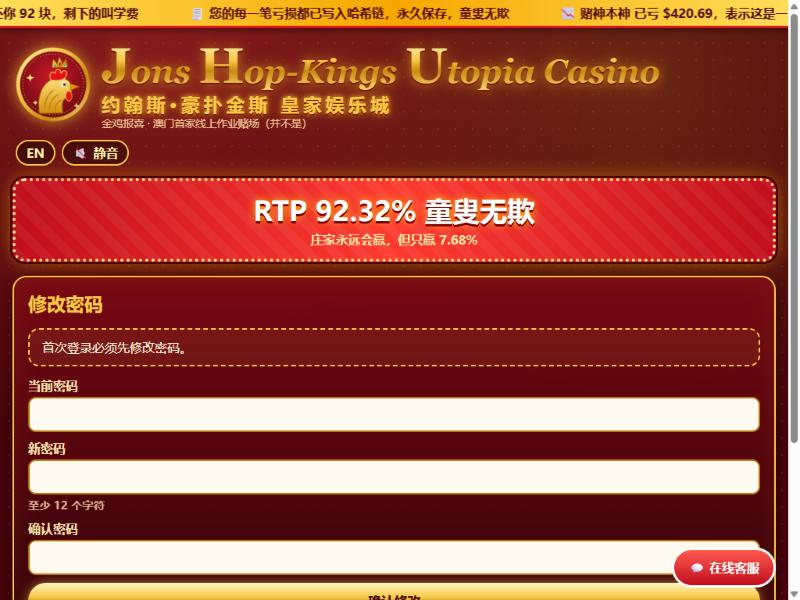
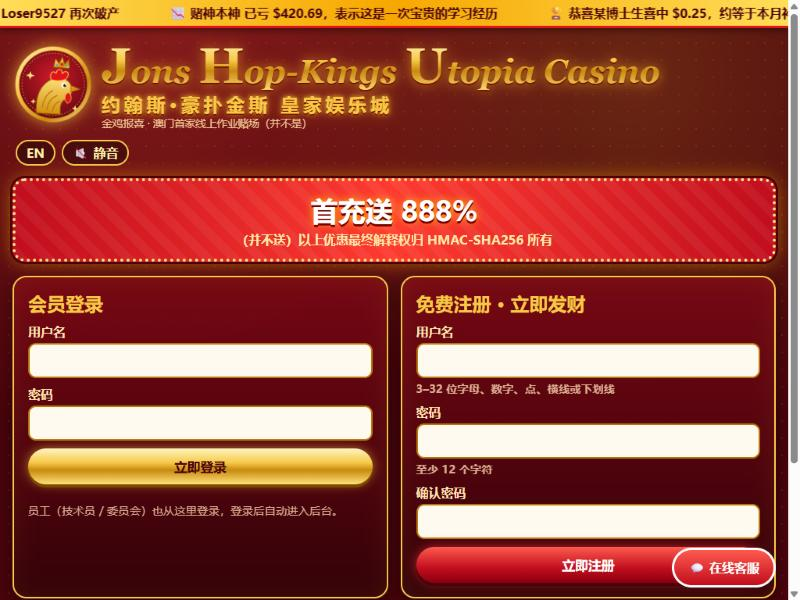
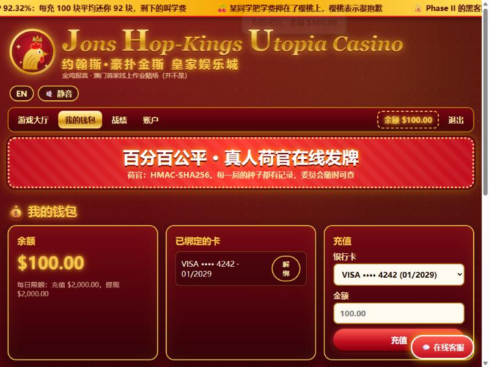
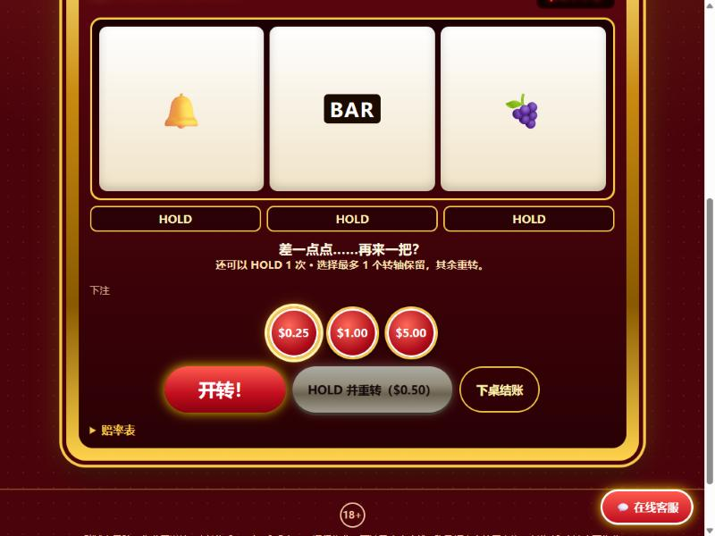
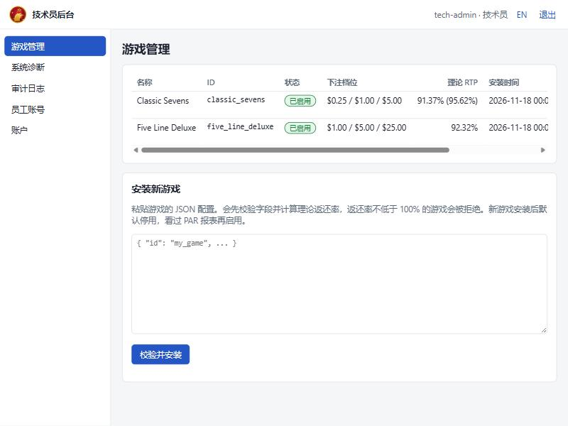
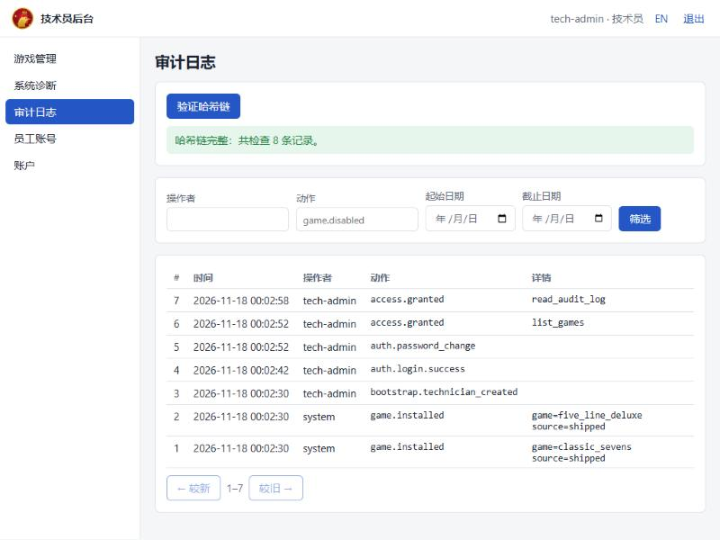
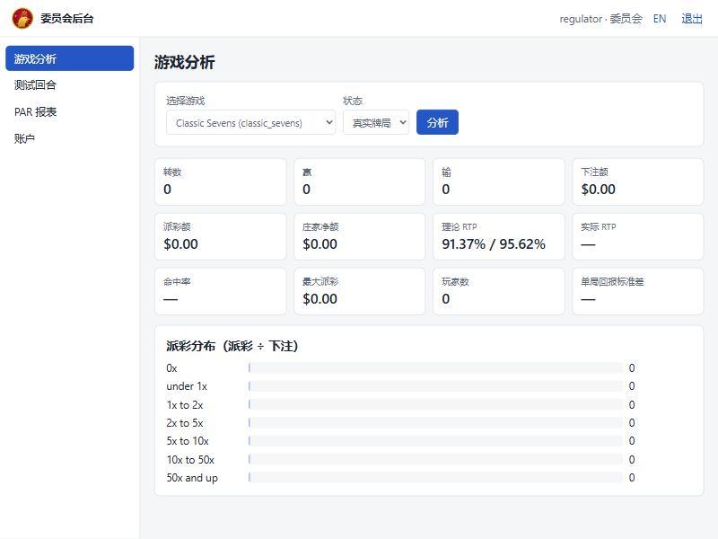

# User manual

Jons **H**op-Kings **U**topia Casino is a course project for Security & Privacy
in Computing. No real money is involved. The player pages are a deliberate
parody of a gaudy online casino; the staff back office is plain.

Install and start it with [INSTALL.md](INSTALL.md), then open
`http://127.0.0.1:8888/`. The language button (中文 / EN) at the top switches
every page between Chinese and English.

There are three kinds of account:

| Role | Gets in by | Can |
| --- | --- | --- |
| Player | Registering on the front page | Add cards, deposit, withdraw, play, see own statistics |
| Technician | First run (`tech-admin`), or created by a technician | Manage games, run diagnostics, read and verify the audit log, create staff accounts |
| Commissioner | Created by a technician | Analyse games, read PAR sheets, run test sessions with visible seeds |

Everyone logs in on the same front page. Staff go straight to the back office.

## Getting started

1. The first run prints a one-time password for `tech-admin` in the terminal.
2. Log in with it. You must choose a new password before anything else opens.

   

3. In **Staff**, create a commissioner account. Its one-time password is shown
   once on screen; hand it over in person. The commissioner must change it at
   first login.
4. Players register themselves on the front page.

Passwords need at least 12 characters. Five wrong passwords lock an account
for 15 minutes; there is no reset that skips the wait.

## For players

### Register and log in

Fill in **Sign up** with a username (3–32 letters, digits, dots, hyphens or
underscores) and a password, then log in on the left.

### Wallet

- **Add a card.** Use the test card `4242 4242 4242 4242`, any future expiry,
  and any 3-digit CVV. Only the brand, last four digits and expiry are kept.
- **Deposit** moves money from a card to your balance; **Withdraw** moves it
  back. Each is limited to $2,000.00 per UTC day.
- **Remove** unlinks a card.

### Choose a game and buy in

The lobby shows the open games with their bets and theoretical return to
player (RTP). **Play** asks how much to buy in: that amount moves from your
balance into credits for this machine. You can have one game open at a time.

| Game | Layout | Paylines | Bets | Holds |
| --- | --- | --- | --- | --- |
| Classic Sevens | 3 reels × 1 row | 1 | $0.25 / $1 / $5 | Yes |
| Five Line Deluxe | 5 reels × 3 rows | 5 (three rows, V and Λ) | $1 / $5 / $25 | No |

A line pays for matching symbols counted from the leftmost reel. Open
**Paytable** under the machine for every combination.

### Spin, hold, cash out

1. Pick a bet (the round chips) and press **SPIN!**. The result is decided by
   the server before the reels stop; the animation is decoration.
2. Classic Sevens only: after a fresh spin you may **HOLD** one reel and press
   **Hold & re-spin**. The held reel stays put and the others spin again. A
   re-spin costs twice the original bet and pays on the original bet. One hold
   in a row, then spin fresh.
3. **Cash out** returns all credits to your balance and shows the result of
   the visit. If the program stops while you are playing, your credits are
   returned at the next start.

### Statistics

**My stats** shows games played, spins, total wagered and won, net result,
win rate, biggest payout, totals per game and your recent visits. Only your
own play is counted.

## For technicians

### Games

- **Enable / Disable** shows or hides a game from players. Disabling refuses
  new buy-ins; a player already at the machine can finish and cash out. Each
  change is logged.
- **PAR sheet** shows the game's reel strips, paytable, exact RTP and hit
  frequency.
- **Install a game**: paste a JSON game config. It is validated, its exact RTP
  is computed (with perfect holds if it has them), and a game returning 100%
  or more is refused. A new game starts disabled: read its PAR sheet, then enable it.

### Diagnostic

For every game: spins, wins, losses, amount wagered and paid, house net,
observed against theoretical RTP, hit rate, unique players, spins per day and
the largest win. Commissioner test rounds are not counted.

### Audit log

- Filter by actor, action (for example `game.disabled`, `auth.login.failure`)
  and dates; page with **Newer / Older**.
- **Verify hash chain** recomputes every entry. An edited or removed entry is
  reported by number, for example `Chain broken at entry 42: hash mismatch`.

### Staff

Create technician or commissioner accounts. The one-time password appears
once; copy it and hand it over. The list shows who still has to change their
password and who is locked out.

## For commissioners

### Analysis

Pick a game and **Live play** or **Test rounds**: spins, wins, losses, money in
and out, theoretical against observed RTP, hit rate, largest win, the spread of
return per spin, and a histogram of payouts as a multiple of the bet.

### Test session

Choose a game (disabled games too), a bet, a number of rounds (up to 100,000)
and a virtual bankroll, then **Run test**. Each round uses the same random
number generator and engine as real play. The report shows every round's seed
(the first 1,000 rounds in the table), stops, symbols, payout and running
bankroll, plus a summary. Afterwards every round is replayed from its seed and
the page reports whether all of them match.

Test rounds never touch any account and are kept out of player statistics and
the technician diagnostic.

### PAR sheet

The same report technicians see, for any installed game.

## Troubleshooting

| Problem | What to do |
| --- | --- |
| "Invalid username or password" | Check the username and password. After five failures, wait 15 minutes. |
| Lost the `tech-admin` password before first login | Stop the program, delete the database file, and start again (this erases everything). |
| A staff member forgot their password | There is no reset. A technician creates a new account for them. |
| "Port 8888 is in use" | Close the other program, or start with `--port 8890`. |
| "this page is out of date; reload it" | Reload the page; your login may have been renewed in another tab. |
| "please log in" | The login expired after 30 idle minutes or 8 hours. Log in again. |
| Credits missing after a crash | They were returned to your balance when the program restarted. |
